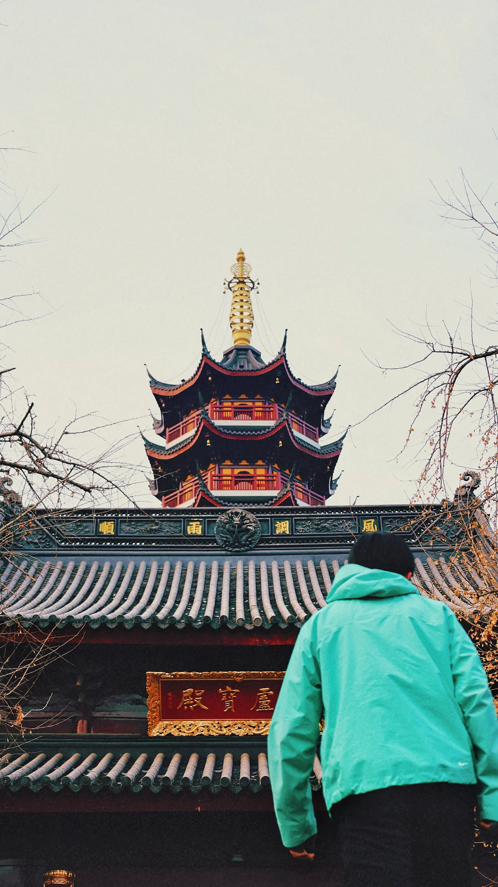
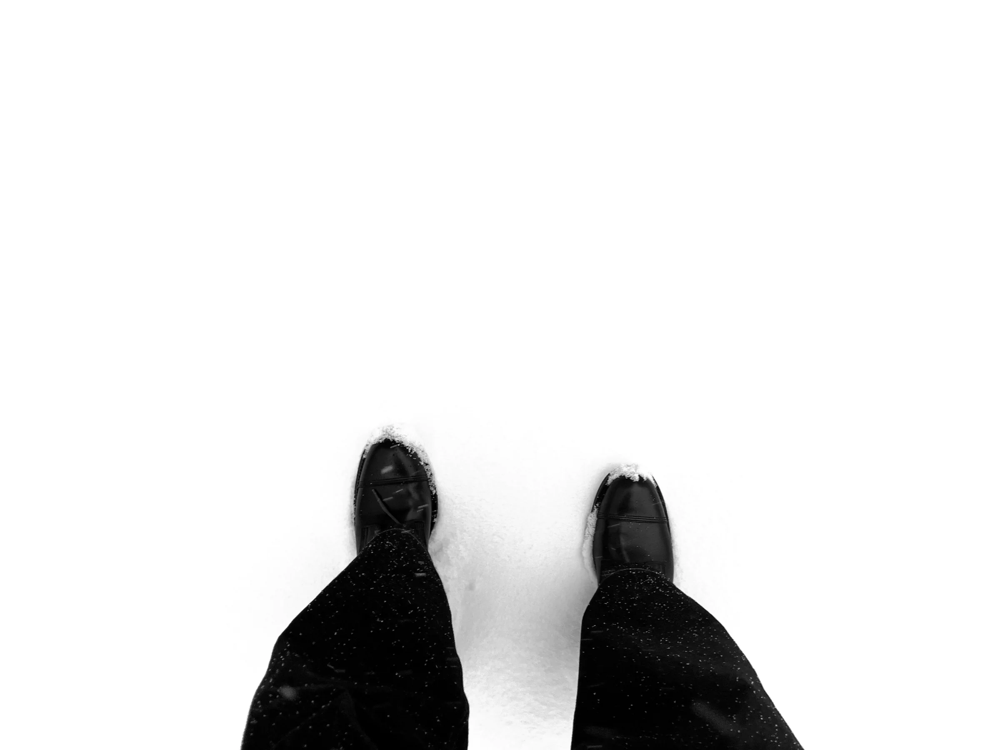

# 2025 collections

[← All collections](/photos)

## Nanjing · Jiming Temple

  <figure>
    
    <figcaption>Jiming Temple · Candlelight</figcaption>
  </figure>
  <figure>
    
    <figcaption>Jiming Temple · A visitor</figcaption>
  </figure>

## Dali · Erhai Lake

  <figure>
    
    <figcaption>Erhai Lake · Sunset</figcaption>
  </figure>
  <figure>
    
    <figcaption>Erhai Lake · Lakeside</figcaption>
  </figure>

## Xi'an · Xidian University

  <figure>
    
    <figcaption>Xidian University · Graduation</figcaption>
  </figure>

## Beijing

  <figure>
    
    <figcaption>Beijing · Snow</figcaption>
  </figure>

