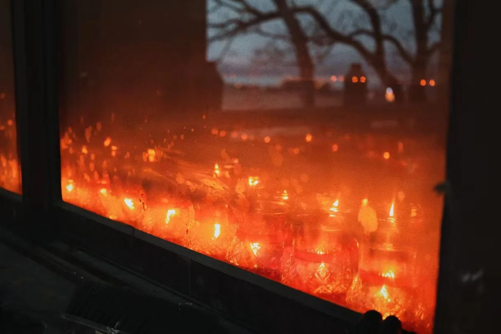
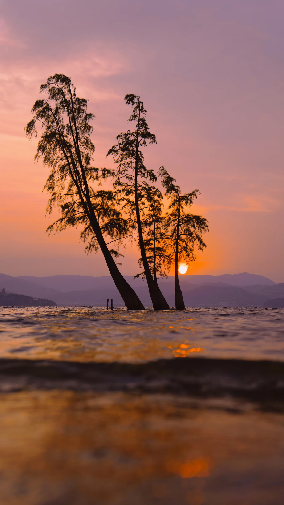
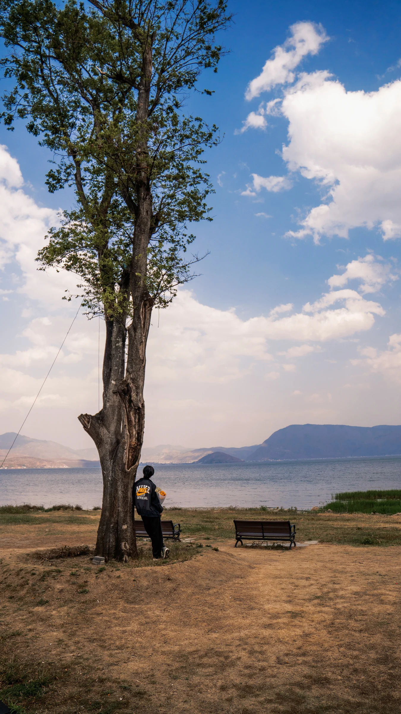
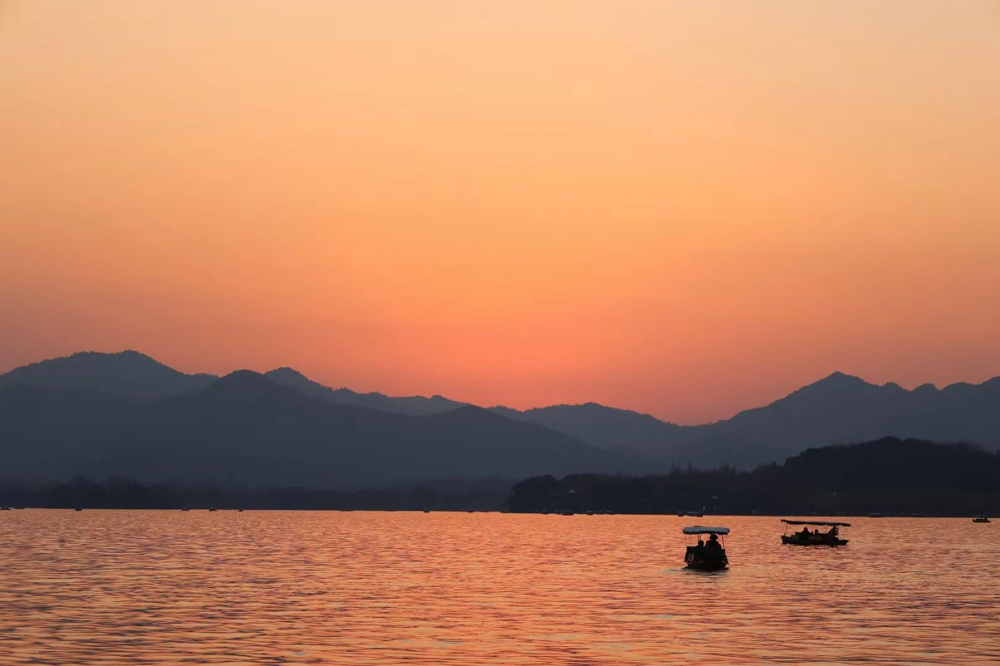

# 2025 collections

[All collections](/photos/)

## Nanjing · Jiming Temple

  <figure>
    
    <figcaption>Jiming Temple · Candlelight</figcaption>
  </figure>
  <figure>
    
    <figcaption>Jiming Temple · A visitor</figcaption>
  </figure>

## Dali · By the Lake

  <figure>
    
    <figcaption>Erhai Lake · Sunset</figcaption>
  </figure>
  <figure>
    
    <figcaption>Erhai Lake · Lakeside</figcaption>
  </figure>

## Hangzhou · Evening Light

  <figure>
    
    <figcaption>West Lake · Sunset</figcaption>
  </figure>

## Beijing · Snowfall

  <figure>
    
    <figcaption>Beijing · Snow</figcaption>
  </figure>

