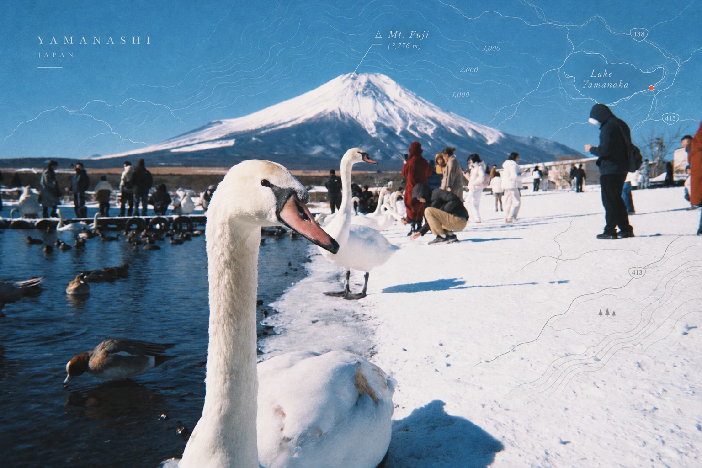
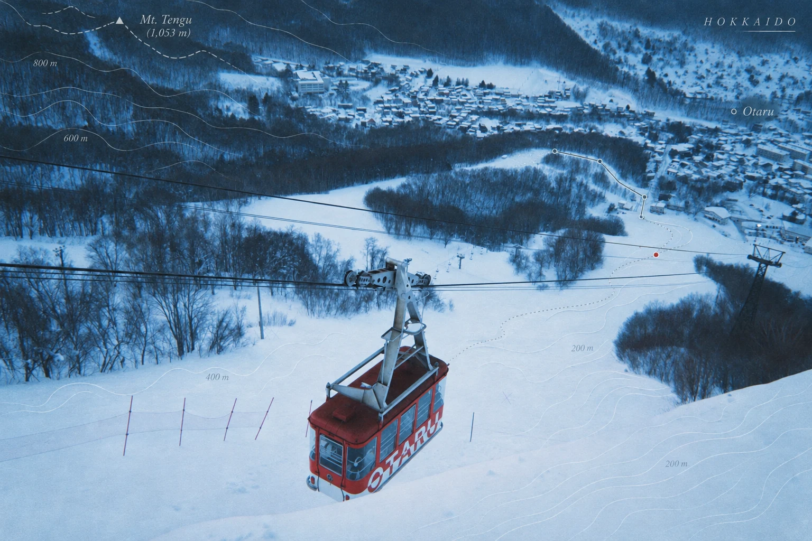
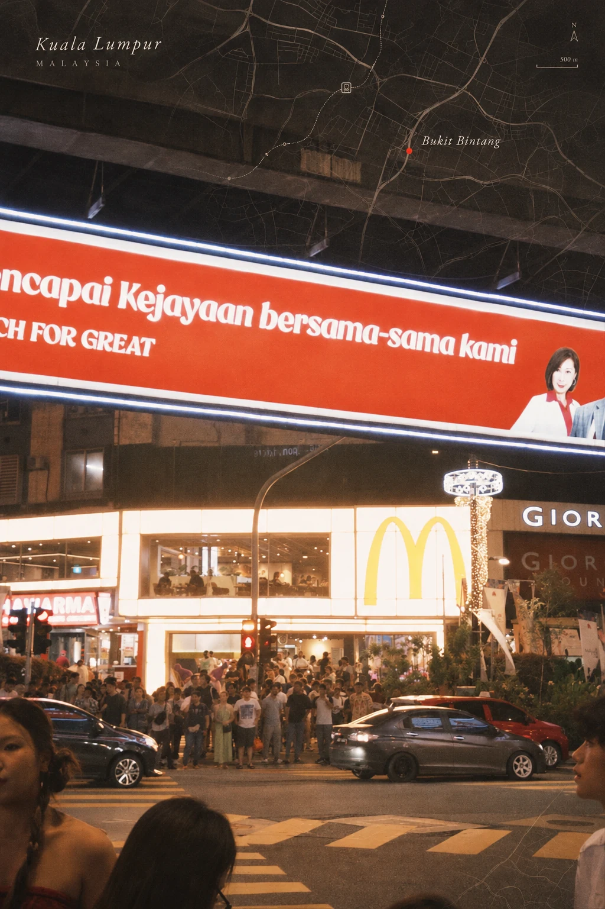
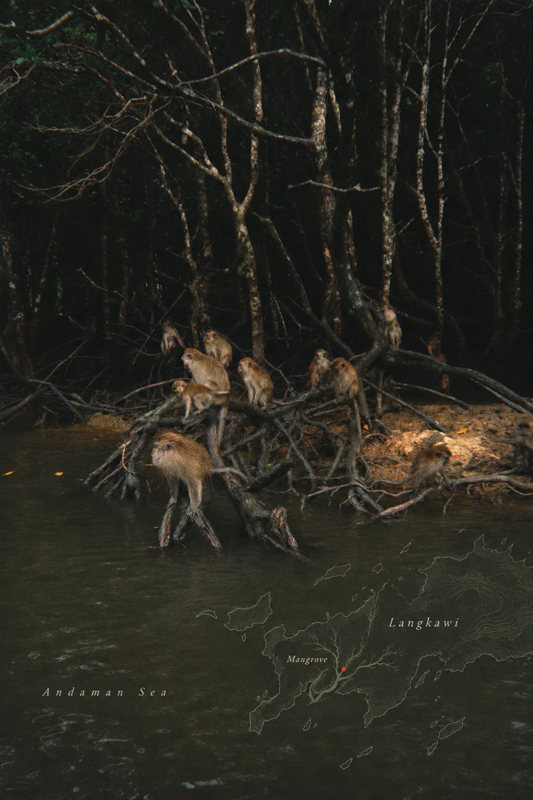
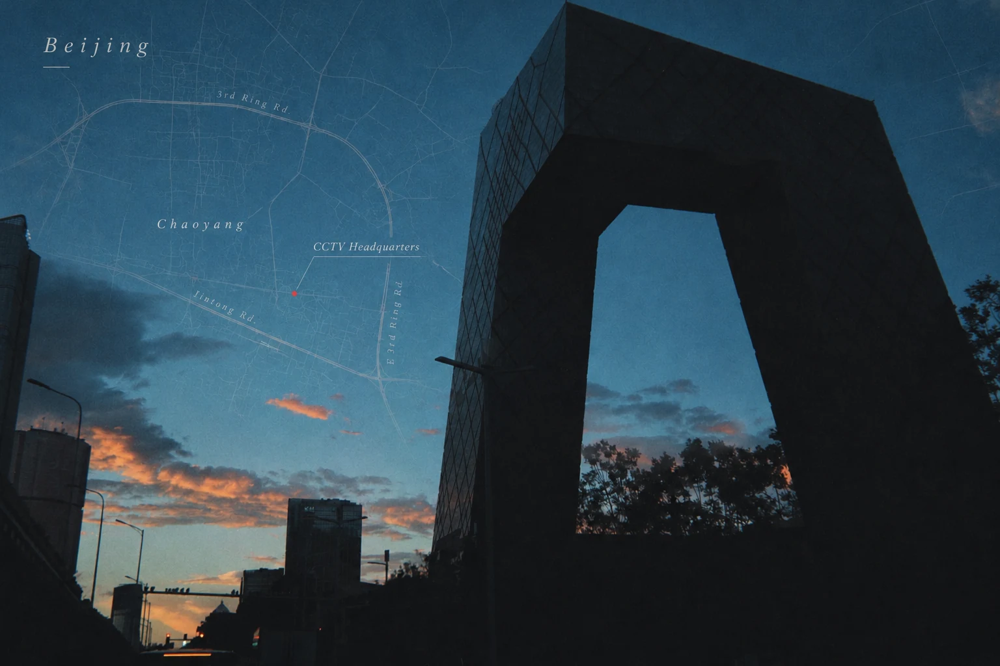
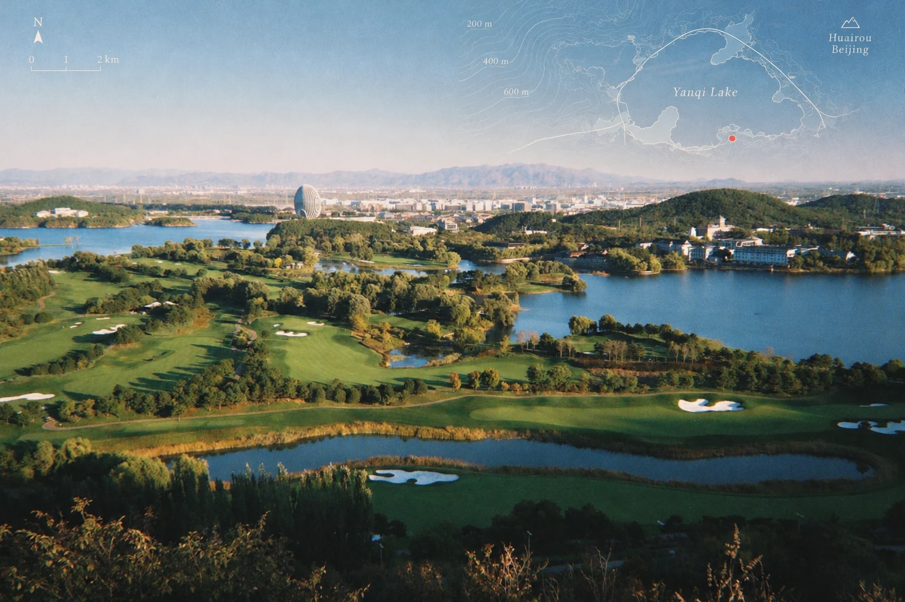

# 2026 collections

[← All collections](/photos)

## Japan

  <figure>
    
    <figcaption>Yamanashi · Lake Yamanaka</figcaption>
  </figure>
  <figure>
    
    <figcaption>Hokkaido · Otaru</figcaption>
  </figure>

## Malaysia

  <figure>
    
    <figcaption>Kuala Lumpur · Bukit Bintang</figcaption>
  </figure>
  <figure>
    
    <figcaption>Langkawi · Mangroves</figcaption>
  </figure>

## Beijing

  <figure>
    
    <figcaption>Chaoyang · CCTV Headquarters</figcaption>
  </figure>
  <figure>
    
    <figcaption>Huairou · Yanqi Lake</figcaption>
  </figure>

